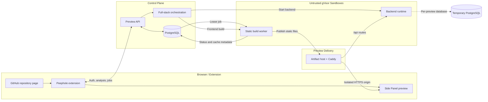

<p align="center">
  
</p>

<h1 align="center">Peephole</h1>

<p align="center">
  <a href="./README.md">English</a> | 한국어
</p>

<p align="center">
  <strong>GitHub 저장소를 클론하기 전에 먼저 확인하세요.</strong>
</p>

<p align="center">
  <a href="https://chromewebstore.google.com/detail/peephole/fieofkhijgngfoflgpkbghbkaidhdgel">Chrome Web Store에서 설치</a>
  ·
  <a href="https://github.com/The-peephole/peephole/releases/latest">최신 GitHub 릴리스</a>
</p>

<p align="center">
  Peephole은 지원되는 공개 GitHub 저장소를 클론하기 전에 분석하고, 조건을 만족하는 정적 프론트엔드를 미리 보여 주며, 지원되는 좁은 형태의 프론트엔드 + 백엔드 구조에 대해서는 풀스택 미리보기를 실행합니다. 신뢰할 수 없는 코드는 격리된 gVisor 샌드박스에서만 실행되고, 결과는 Chrome 사이드 패널에서 HTTPS로 열립니다.
</p>

<p align="center">
  <a href="https://github.com/The-peephole/peephole/actions/workflows/ci.yml">
    
  </a>
</p>

<p align="center">
  
</p>

<p align="center">
  <em>정적 미리보기 시연: 저장소를 분석하고, 정확한 커밋을 격리된 gVisor 샌드박스에서 빌드한 뒤, 결과를 GitHub 화면에서 바로 확인합니다. 이 영상에는 풀스택 미리보기가 포함되어 있지 않습니다.</em>
</p>

## 왜 Peephole인가?

저장소를 파악하려면 보통 클론부터 하고, `package.json`을 살펴보고, 의존성을 설치하고, 맞는 실행 명령을 찾은 다음에야 비밀 값이나 백엔드, 지원되지 않는 도구가 필요하다는 사실을 알게 됩니다.

Peephole은 먼저 범위가 제한된 저장소 분석을 수행합니다. 프레임워크, 패키지 매니저, 빌드 계획, 미리보기 가능 여부, 그리고 차단 요인과 경고를 찾아냅니다. 지원되는 미리보기 계약(정적 프론트엔드 또는 좁은 범위의 풀스택 구조)을 만족하는 대상만 격리 실행으로 넘어가고, 나머지는 이유를 명확히 설명한 채 분석 단계에서 멈춥니다.

## 기능

| 기능                          | 하는 일                                                                                                                                                                                                              |
| ----------------------------- | -------------------------------------------------------------------------------------------------------------------------------------------------------------------------------------------------------------------- |
| 저장소 분석                   | 알려진 저장소 파일을 바탕으로 프레임워크, 패키지 매니저, 빌드 계획, 차단 요인, 경고를 탐지합니다.                                                                                                                    |
| 구조 및 대상 탐지             | 저장소 루트와 범위가 제한된 하위 디렉터리를 분석해 프론트엔드·백엔드 후보를 보여 주고, 지원되는 후보를 선택하게 하며, 다른 후보가 왜 대상이 될 수 없는지 설명합니다.                                                 |
| 브랜치 선택                   | 범위가 제한된 목록에서 원하는 브랜치를 고를 수 있으며, 선택한 브랜치는 분석 전에 정확한 커밋 SHA로 해석됩니다.                                                                                                       |
| 커밋 고정 미리보기            | 바뀔 수 있는 브랜치 끝을 신뢰하지 않고, 정확한 Git 커밋을 해석해 빌드합니다.                                                                                                                                         |
| 정적 미리보기                 | 지원되는 정적 프론트엔드를 격리 환경에서 빌드해 격리된 HTTPS 오리진으로 사이드 패널에 보여 줍니다. 준비된 미리보기는 닫았다가 다시 열 수 있고, 만료되면 **Build again**으로 다시 빌드할 수 있습니다.                 |
| 풀스택 미리보기               | 지원되는 Vite + React 프론트엔드와 Express + npm 백엔드를 하나의 HTTPS 미리보기 오리진에서 실행하며, `/api`만 백엔드로 라우팅합니다. **Run full-stack preview**로 시작하고 **Stop full-stack preview**로 종료합니다. |
| 임시 PostgreSQL               | 지원되는 풀스택 백엔드가 정확히 `pg`와 `DATABASE_URL`을 선언하면, 해당 미리보기 전용 데이터베이스와 역할을 만들고 중지 시나 크래시 후에 정리합니다.                                                                  |
| 민감하지 않은 환경 설정 (M12) | `.env.example` 계열 파일에서 설정 *이름*을 읽고, 실행 전에 민감하지 않은 값을 입력받아 해당 미리보기 런타임에만 전달합니다. 비밀 값과 API 키는 받지 않습니다.                                                        |
| 미리보기 유지                 | 대상이나 브랜치를 바꾸는 동안 실행 중인 풀스택 미리보기의 작업 공간과 제어 버튼을 유지하고, 지원되는 GitHub 페이지를 오갈 때 사이드 패널 맥락과 저장된 미리보기를 복원합니다.                                        |
| GitHub 연동                   | 저장소 개요 페이지의 액션 영역에서 열리고, GitHub 탐색 흐름을 따라가며, GitHub Light, Dark, Dark Dimmed 또는 호환되는 Primer 테마에 맞춰집니다.                                                                      |
| GitHub 인증                   | GitHub App OAuth를 사용하며, 확장 프로그램은 수명이 짧은 Peephole 세션만 저장합니다.                                                                                                                                 |
| 격리 실행                     | 신뢰할 수 없는 설치·빌드·백엔드 작업을 gVisor 안에서 non-root 사용자로, 리소스와 네트워크를 제한한 채 실행합니다.                                                                                                    |

## 버전별 주요 기능

| 버전   | 주요 기능                                                                                                                       |
| ------ | ------------------------------------------------------------------------------------------------------------------------------- |
| v0.1.0 | GitHub 저장소 분석, 정적 프론트엔드 미리보기, Chrome 사이드 패널                                                                |
| v0.2.0 | 브랜치 선택, 저장소 구조 탐지, 프론트엔드 대상 선택, GitHub 테마 연동, 배포 기록 확인                                           |
| v0.3.0 | 풀스택 미리보기, 임시 PostgreSQL 연동, 민감하지 않은 환경 설정(M12), 사이드 패널 탐색 및 미리보기 복원, 작업 공간 및 UI/UX 개선 |

배포 채널마다 최신 공개 버전이 다를 수 있으니, 실제로 설치되는 버전은 위 각 링크에서 확인하세요.

## 동작 방식

### 정적 미리보기

1. 공개 GitHub 저장소를 열고 저장소 액션 영역에서 Peephole을 선택합니다.
2. 사이드 패널에서 탐지된 스택, 구조, 빌드 계획, 차단 요인, 미리보기 가능 여부를 확인합니다.
3. GitHub를 연결한 뒤 지원되는 대상에서 **Build preview**를 선택합니다.
4. Peephole이 정확한 커밋을 검증한 뒤 격리된 gVisor 샌드박스 안에서 빌드합니다.
5. 생성된 정적 앱이 HTTPS로 사이드 패널에 표시되며, 닫았다가 다시 열 수 있습니다.

### 풀스택 미리보기

지원되는 풀스택 구조와 일치하는 저장소에서만 사용할 수 있습니다([지원 프로젝트](#지원-프로젝트) 참고).

1. 저장소와 Peephole 사이드 패널을 엽니다.
2. 저장소 루트 또는 하위 디렉터리에서 탐지된 프론트엔드·백엔드 후보를 확인합니다.
3. 지원되는 프론트엔드와 백엔드를 선택합니다.
4. 백엔드가 민감하지 않은 설정 이름을 선언했다면 **Environment variables**에 값을 입력합니다.
5. 필요하면 GitHub를 연결한 뒤 **Run full-stack preview**를 선택합니다.
6. 하나의 HTTPS 미리보기 오리진에서 프론트엔드와 `/api` 백엔드를 사용합니다.
7. 사용이 끝나면 **Stop full-stack preview**를 선택합니다.

## 아키텍처



확장 프로그램은 제어와 화면 표시만 담당하며, 저장소 소스 코드는 신뢰할 수 없는 샌드박스 경계 안에서만 실행됩니다. 작업이 워커에 도달하기 전에 서버가 저장소 식별 정보, 커밋, 실행 가능 여부를 독립적으로 검증합니다. 풀스택 미리보기는 프론트엔드에 정적 빌드 경로를 그대로 사용하고, 백엔드는 별도 샌드박스에서 시작하며, 둘을 하나의 오리진에서 제공하되 `/api`만 백엔드로 보냅니다. 서버 생성 비밀 값(M10), 임시 데이터베이스 URL(M11), 사용자 제공 비민감 설정(M12)은 각각 별도의 전달 경로이며, 하나의 범용 비밀 값 주입 기능이 아닙니다.

## 보안 모델

**지원된다는 것이 신뢰한다는 뜻은 아닙니다.** Peephole은 모든 저장소와 의존성 라이프사이클 스크립트를 신뢰할 수 없는 입력으로 취급합니다.

- 저장소 소스 코드는 확장 프로그램 안에서 절대 실행되지 않습니다.
- 미리보기 작업은 정확한 Git 커밋에 고정됩니다.
- 설치와 빌드 명령은 실제 gVisor 안에서 non-root 사용자로 실행됩니다.
- 게스트 루트 파일 시스템은 읽기 전용이며, 작업 공간은 loop 장치 기반 ext4로 용량이 엄격히 제한됩니다.
- 작업마다 CPU, 메모리, 프로세스 수, 임시 저장 공간, 실행 시간(wall-clock)에 상한이 있습니다.
- 빌드 단계에서는 네트워크가 비활성화되고, 설치 단계에서는 사설망, 링크 로컬, 메타데이터, 호스트, 다른 작업으로의 접근이 차단됩니다.
- 미리보기 아티팩트는 확장 프로그램이나 컨트롤 플레인 권한이 없는 격리된 오리진에서 제공됩니다.
- 디스크, 네트워크, 샌드박스의 소유 관계는 영속적으로 기록되며, 크래시 후에는 이를 기준으로 대조·정리됩니다.
- 풀스택 백엔드는 자체 gVisor 샌드박스에서 실행되고 외부 접근이 차단되며(해당 미리보기의 임시 데이터베이스만 예외), 런타임 자체에는 공개 URL이 없습니다.
- M10, M11, M12 값은 백엔드 시작 시 서로 다른 메모리 기반 파일로 전달되며, OCI `process.env`를 거치지 않습니다.
- M12 값은 공개 설정으로 취급합니다. 저장소 코드와 미리보기 방문자가 읽을 수 있으므로 민감하지 않은 이름만 받습니다.

구현 세부 사항과 남아 있는 위험은 [Preview runtime](docs/PREVIEW_RUNTIME.md), [Sandbox disk security](docs/SANDBOX_DISK_SECURITY.md), [Sandbox network security](docs/SANDBOX_NETWORK_SECURITY.md) 문서에 정리되어 있습니다.

## 현재 검증 현황

Peephole의 프로덕션 경로는 AWS EC2 Ubuntu에서 운영됩니다. 정적 미리보기는 Chrome 확장 프로그램을 통해 E2E로 검증되었고, 확장 프로그램을 통한 풀스택 경로는 아직 아래의 제한된 M12 Canary에서만 확인되었습니다. 아래 항목은 특정 환경에서 기록된 검증 결과이며, 문서만 바뀌었다고 해서 다시 확인된 것은 아닙니다.

| 검증 항목                                            | 기록된 결과                                                                                                                                                                                                                                                                                                                                    |
| ---------------------------------------------------- | ---------------------------------------------------------------------------------------------------------------------------------------------------------------------------------------------------------------------------------------------------------------------------------------------------------------------------------------------- |
| GitHub App 인증                                      | OAuth, PKCE, 서명된 state, 허용된 `chromiumapp.org` 리디렉션, Peephole 세션 발급을 E2E로 검증                                                                                                                                                                                                                                                  |
| 실제 gVisor 샌드박스 회귀 테스트                     | 프로덕션과 유사한 Linux 호스트에서 통과                                                                                                                                                                                                                                                                                                        |
| 실제 gVisor 골든 패스                                | 실제 `npm ci`와 Vite/esbuild로 통과                                                                                                                                                                                                                                                                                                            |
| 아티팩트 전달                                        | HTTPS 게시와 Chrome 사이드 패널 표시 검증                                                                                                                                                                                                                                                                                                      |
| 크래시 복구                                          | `SIGKILL`, systemd 재시작, 큐 복구, 시작 시 runsc/디스크/네트워크 정리 검증                                                                                                                                                                                                                                                                    |
| 최종 리소스 잔여물                                   | runsc 컨테이너, 네임스페이스, veth, 방화벽 규칙, 마운트, loop 장치, lease, 작업 파일이 남지 않음                                                                                                                                                                                                                                               |
| 캐시 무효화                                          | 러너 보안 변경 후 `runnerVersion: "production-2"`로 예상대로 새 빌드가 강제됨                                                                                                                                                                                                                                                                  |
| Portable CI                                          | 포맷, 린트, 타입 검사, portable 테스트, 확장 프로그램 빌드를 CI에서 강제                                                                                                                                                                                                                                                                       |
| PostgreSQL 통합 테스트                               | 통과                                                                                                                                                                                                                                                                                                                                           |
| 실제 gVisor `backend-v1` 런타임 (M9)                 | 프로덕션 호스트에서 readiness, `/api/hello`, 외부 접근 차단(공용 인터넷/메타데이터/사설망/링크 로컬/호스트/다른 작업), default route 없음, 런타임 NAT 없음, 멱등 정리를 검증                                                                                                                                                                   |
| `fullstack-v1` 프론트엔드 ↔ 백엔드 라우팅 (M9)       | 인증된 미리보기가 `ready`에 도달했고, HTTPS 오리진이 프론트엔드를 제공하며 `/api/hello`를 실제 백엔드로 라우팅                                                                                                                                                                                                                                 |
| 재시작 시 `fail-closed` (M9)                         | 미리보기가 `ready`인 상태에서 `peephole`을 재시작하면 해당 미리보기가 무효화되고(안전한 쪽으로 실패) runsc/네트워크 잔여물이 남지 않음. 백엔드 접속 정보는 재구성되지 않음                                                                                                                                                                     |
| GitHub 업스트림 가용성 / 요청 한도 (PR #22, M9)      | 서버 소유 `PEEPHOLE_GITHUB_TOKEN`을 설정해, 자격 증명을 출력하지 않고 시간당 5000회(인증 없이는 60회)로 늘어난 것을 확인                                                                                                                                                                                                                       |
| 생성 비밀 값 (M10, 2026-09-28)                       | 네 개 이름 허용 목록에 대해 프로덕션 검증                                                                                                                                                                                                                                                                                                      |
| 임시 PostgreSQL (M11, 2026-10-07)                    | 프로덕션 검증: 데이터베이스를 사용하는 풀스택 미리보기, 미리보기별 데이터베이스와 역할, 중지 시 회수                                                                                                                                                                                                                                           |
| M12 실제 gVisor (2026-10-13, `5ed0f92`)              | 전용 Linux 호스트에서 lifecycle 12/12 통과. 이후 수정은 portable 검증만 완료                                                                                                                                                                                                                                                                   |
| M12 제한적 Production Canary (2026-10-16, `aa26a11`) | Chrome 확장 프로그램으로 풀스택 미리보기를 실행해 프론트엔드와 백엔드가 정상 동작했고, 합성 값 `APP_GREETING`이 전달·표시되었으며, 정상적으로 중지되었습니다. 테넌트와 호스트 잔여물은 0이었고, 이후 서버는 M12 OFF인 안정 버전으로 롤백되었습니다. 이때 사용한 확장 프로그램은 v0.3.0 이전의 테스트 빌드이며 최종 v0.3.0 아티팩트가 아닙니다. |

위의 M9 항목 네 개는 당시 확장 프로그램에 `backend-v1`/`fullstack-v1` UI가 없었기 때문에 프로덕션 API와 호스트에 직접 대고 검증한 결과입니다. v0.3.0 후보 빌드에는 풀스택 제어 UI가 포함되어 있습니다. 환경 의존적인 실제 gVisor 테스트는 프로덕션과 유사한 Linux 호스트에서 별도로 실행하며, 의도적으로 portable CI에 포함하지 않습니다.

아직 완료되지 않은 항목: 최종 v0.3.0 확장 프로그램과 Production의 E2E 실행, 현재 후보 기준 Linux lifecycle 및 격리 journal 검증(B1)과 M12를 포함한 실제 서버 크래시 복구 검증(B2)(테스트 하네스는 있으나 실제 호스트에서 실행하지 않았으며, 릴리스 책임자가 v0.3.0에 대해 이 잔여 위험을 수용함), 별도 보안 승인 항목(B3), 그리고 Production M12 정식 적용입니다. 자세한 내용은 [M12 Canary 종료 및 릴리스 게이트](docs/M12_PRODUCTION_CANARY_20261016.md)를 참고하세요.

`main`에서 수동 실행한 [`Real golden-path build tests`](https://github.com/The-peephole/peephole/actions/runs/35069679620) 워크플로가 현재 퍼스트파티 픽스처로 머지 커밋 `dba47191bdd3600b3f451945653efab2363028c2`에서 성공했습니다. 이 워크플로는 실제 네트워크를 사용하는 CI이며, [Production smoke verification](docs/PRODUCTION_SMOKE.md)에 설명된 운영자 수행 프로덕션 스모크 테스트와는 다릅니다.

## 지원 프로젝트

| 수준                             | 현재 범위                                                                                                                                                                                                                                                                                                                                                                                                                               |
| -------------------------------- | --------------------------------------------------------------------------------------------------------------------------------------------------------------------------------------------------------------------------------------------------------------------------------------------------------------------------------------------------------------------------------------------------------------------------------------- |
| 정적 미리보기                    | 저장소 루트의 정적 HTML, 그리고 npm과 대상 디렉터리 자체의 `package-lock.json`을 사용하는 루트 또는 명시적으로 선택한 하위 Vite + React 대상                                                                                                                                                                                                                                                                                            |
| 풀스택 미리보기 (`fullstack-v1`) | 서로 다른 디렉터리에 있는 지원되는 Vite + React + npm 프론트엔드 하나와 Express + npm 백엔드(`express-node-npm-v1`, 대상 디렉터리 자체 lockfile) 하나. 저장소 루트 또는 하위 디렉터리에서 탐지합니다. 하나의 동일 오리진 HTTPS 미리보기가 `/api`/`/api/*`만 백엔드로 라우팅하며, 백엔드 런타임 자체에는 공개 URL이 없습니다. 플랫폼 변수는 `PORT`/`HOST`/`NODE_ENV`로 고정됩니다.                                                       |
| 풀스택 추가 기능                 | 각각 별도의 전달 경로를 사용합니다. M10: 서버가 정확히 `JWT_SECRET`, `SESSION_SECRET`, `COOKIE_SECRET`, `CSRF_SECRET` 값을 생성합니다. M11: 백엔드가 정확히 `pg`와 `DATABASE_URL`을 선언하면 임시 PostgreSQL 데이터베이스를 제공합니다. M12: 서버와 확장 프로그램 빌드가 모두 활성화한 경우, 저장소가 선언한 민감하지 않은 이름에 대해 사용자가 입력한 값을 전달합니다. [사용자 제공 환경 설정](docs/USER_PROVIDED_ENVIRONMENT.md) 참고 |
| 분석 및 선택                     | 범위가 제한된 목록(최대 100개)에서 브랜치를 선택해 정확한 커밋으로 해석, 구조 및 프론트엔드·백엔드 후보 탐지, 백엔드 근거(프레임워크, 데이터베이스 의존성, 검증되지 않은 엔트리포인트), 값을 읽지 않는 `.env.example` 계열 변수 _이름_ 분류, 선언된 홈페이지와 구분해 보여 주는 확인된 GitHub Deployments 링크(임베드·프록시하지 않음)                                                                                                  |
| 분석만 지원                      | Vue/Svelte Vite, 다른 패키지 매니저, 모노레포 모호성, 지원 형태를 벗어난 백엔드. 실행 가능한 계획을 만들지 않습니다.                                                                                                                                                                                                                                                                                                                    |
| 미지원                           | 공유 루트 워크스페이스 오케스트레이션(루트에서 찾은 분리된 프론트엔드/백엔드 디렉터리는 지원하지만, 하나의 공유 워크스페이스 실행은 지원하지 않음), 그 밖의 모든 백엔드 런타임, PostgreSQL + `pg` + `DATABASE_URL` 이외의 데이터베이스, 사용자 제공 데이터베이스 자격 증명, 사용자 제공 비밀 값이나 API 키(M12-C는 설계 단계), 비공개 저장소, 임의의 Dockerfile/언어                                                                    |

분석 지원 범위는 실행 지원 범위보다 넓습니다. 공식 Vite + React 골든 패스는 [`The-peephole/peephole-fixture-vite-react`](https://github.com/The-peephole/peephole-fixture-vite-react)의 커밋 `4a2c3b78e15d90865ed565c3d38c4045b5a5235f`(저장소 id `1371620276`)입니다. [`peephole-fixture-fullstack`](https://github.com/The-peephole/peephole-fixture-fullstack) 저장소는 두 경로를 모두 다룹니다. `frontend` 디렉터리만 일반 정적 Build Preview로 빌드하면(커밋 `eae411a288b212201933cebb206126dd5bb0d93e`) `backend`는 시작되지도 라우팅되지도 않으므로 `/api/hello` 요청은 설계상 실패하고, `fullstack-v1` 미리보기로 만들면 `/api`가 실제 백엔드에 도달합니다. M12 Canary에서는 커밋 `90afaa0c3f650744300afc5d8fed00fd4a0ef5c8`을 사용했습니다.

## 로컬 개발

Node.js 24와 npm으로 의존성을 설치합니다.

```bash
npm ci
```

`.env.example`을 `.env.local`로 복사하고, 로컬 `PEEPHOLE_DATABASE_URL`을 지정한 뒤 `WXT_PREVIEW_API_BASE_URL`을 `http://127.0.0.1:8787`로 설정하세요. `WXT_` 변수의 값은 확장 프로그램 번들에 그대로 포함되므로, 자격 증명이나 서버 비밀 값을 절대 넣지 마세요.

| 명령                         | 용도                              |
| ---------------------------- | --------------------------------- |
| `npm run dev`                | WXT 확장 프로그램 개발 모드 시작  |
| `npm run dev:preview-server` | 로컬 Preview API와 워커 루프 시작 |
| `npm test`                   | portable Vitest 테스트 실행       |
| `npm run typecheck`          | WXT 타입 생성 후 TypeScript 검사  |
| `npm run lint`               | ESLint 실행                       |
| `npm run build`              | Chrome 확장 프로그램 빌드         |

인증 GitHub 읽기 Gateway는 서버 전용 `PEEPHOLE_GITHUB_GATEWAY_TOKEN`을 사용합니다(scope 없는 classic PAT 필요). 기존 Preview admission 및 서버 GitHub 조회는 `PEEPHOLE_GITHUB_TOKEN`을 계속 사용하며, Gateway 전용 토큰이 없으면 기존 토큰으로 대체하지 않습니다. 서버 `PEEPHOLE_GITHUB_GATEWAY_ENABLED`와 확장 `WXT_GITHUB_GATEWAY_ENABLED`는 모두 기본 OFF입니다. 자세한 내용은 [Gateway 설정](docs/GITHUB_API_REQUEST_OPTIMIZATION.md#configuration-rollout-and-rollback)을 참고하세요.

로컬 미리보기 워커는 의도적으로 샌드박스 없이 동작하므로, 이미 신뢰하는 소스만 빌드해야 합니다. 프로덕션 격리에는 Linux와 gVisor가 필요합니다. 차이점은 [Preview runtime](docs/PREVIEW_RUNTIME.md)을 참고하세요.

## 프로젝트 현황

프로덕션 정적 미리보기 기반, GitHub 테마 연동, Branch Preview, 저장소/애플리케이션 구조 탐지, 명시적 Build Adapter 아키텍처, 범위가 제한된 프론트엔드 대상 선택, 기존 배포 사이트 Live Preview가 구현되어 있습니다. 정확한 범위는 [지원 프로젝트](#지원-프로젝트)를 참고하세요.

4. Build Adapter 일반화 (구현됨)
5. 프론트엔드 대상 선택 / 범위가 제한된 프론트엔드 모노레포 지원 (구현됨)
6. 기존 배포 사이트 Live Preview (구현됨)
7. 백엔드 탐지 + 환경변수 요구사항 분석 (구현됨)
8. backend-v1 실행 기반 구현, M9에서 프로덕션 검증
9. 프론트엔드 ↔ 백엔드 라우팅, M9에서 프로덕션 검증
10. 임시 생성 비밀 값, M10-C4B(2026-09-28)에서 구현 및 프로덕션 검증. 정확히 네 개의 표준 이름으로 제한
11. 임시 데이터베이스 지원, M11(2026-10-07)에서 구현 및 프로덕션 검증. 신뢰된 `fullstack-v1` 미리보기의 PostgreSQL + `pg` + `DATABASE_URL`로 제한
12. 사용자 제공 비민감 설정(M12-A/B) 구현. 2026-10-16 제한적 Production Canary 후 롤백했으며, Production 정식 적용(M12 ON)은 완료되지 않음

v0.3.0은 릴리스 준비 중입니다. 현재 후보 기준 Linux lifecycle(B1)과 실제 서버 크래시 복구(B2) 검증은 실행하지 않았으며, 릴리스 책임자가 2026-10-18에 이 잔여 위험을 수용했습니다. 별도 보안 승인 항목(B3)은 아직 열려 있습니다. 어느 항목도 통과로 기록되지 않았습니다. 자세한 내용은 [M12 Canary 종료 및 릴리스 게이트](docs/M12_PRODUCTION_CANARY_20261016.md)를 참고하세요. 이 기능들은 좁은 범위로 제한되며, 임의의 백엔드, 데이터베이스, 비밀 값, 환경변수를 지원한다는 뜻이 아닙니다(D-033, D-035, docs/TEMPORARY_DATABASES.md, docs/USER_PROVIDED_ENVIRONMENT.md 참고). 별도로 남아 있는 운영 과제로는 접근성 검토, 프로덕션 관측성, 프로덕션 스모크 테스트 자동화, 설치 단계 패키지 외부 접근의 추가 제한, 프로덕션 유사 환경에서의 악성 스크립트 테스트 실행이 있습니다.

## 문서

- [제품 명세](docs/PRODUCT_SPEC.md)
- [아키텍처](docs/ARCHITECTURE.md)
- [Preview 런타임](docs/PREVIEW_RUNTIME.md)
- [저장소 분석 명세](docs/REPOSITORY_ANALYSIS.md)
- [GitHub App 인증](docs/GITHUB_APP_AUTH.md)
- [개인정보 처리방침](PRIVACY.md)
- [Chrome Web Store 등록 정보 및 릴리스 운영](docs/CHROME_WEB_STORE.md)
- [v0.2.0 릴리스 기록](docs/RELEASE_V0.2.0.md)
- [v0.1.0 릴리스 기록 및 남은 점검 항목](docs/RELEASE_V0.1.0.md)
- [요청자 IP 신뢰](docs/REQUESTER_IP_TRUST.md)
- [샌드박스 디스크 보안](docs/SANDBOX_DISK_SECURITY.md)
- [샌드박스 네트워크 보안](docs/SANDBOX_NETWORK_SECURITY.md)
- [MVP 로드맵](docs/MVP_ROADMAP.md)
- [구현 체크리스트](docs/IMPLEMENTATION_CHECKLIST.md)
- [테스트 계획](docs/TEST_PLAN.md)
- [기술 결정 기록](docs/DECISIONS.md)

문서는 영어로 작성되어 있습니다.

---

Peephole은 실행보다 검사를 먼저 합니다. 실행이 꼭 필요할 때는 저장소를 적대적인 것으로 간주하고, 브라우저 확장 프로그램 바깥의 수명이 짧은 샌드박스에서 실행합니다.
