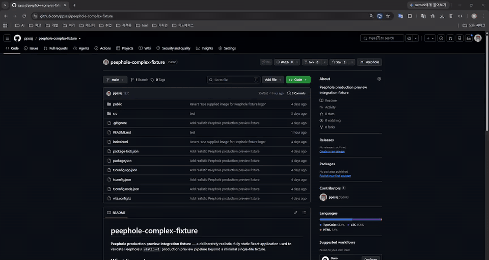
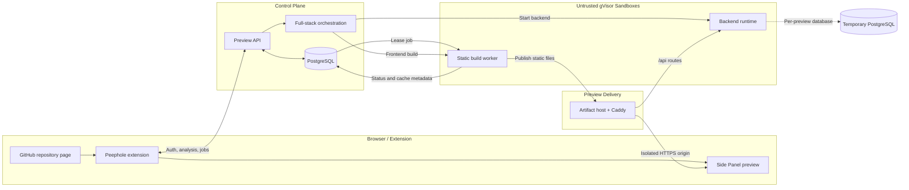

<p align="center">
  
</p>

<h1 align="center">Peephole</h1>

<p align="center">
  English | <a href="./README.ko.md">한국어</a>
</p>

<p align="center">
  <strong>Preview a GitHub repository before you clone it.</strong>
</p>

<p align="center">
  <a href="https://chromewebstore.google.com/detail/peephole/fieofkhijgngfoflgpkbghbkaidhdgel">Chrome Web Store</a>
  ·
  <a href="https://github.com/The-peephole/peephole/releases/latest">Latest GitHub Release</a>
</p>

<p align="center">
  Peephole analyzes supported public GitHub repositories before you clone them, previews eligible static frontends, and runs full-stack previews for a narrow supported frontend + backend shape. Untrusted code runs only in isolated gVisor sandboxes, and the result opens over HTTPS in a Chrome Side Panel.
</p>

<p align="center">
  <a href="https://github.com/The-peephole/peephole/actions/workflows/ci.yml">
    
  </a>
</p>

<p align="center">
  
</p>

<p align="center">
  <em>Static preview demo: analyze the repository, build its exact commit in an isolated gVisor sandbox, and preview the result directly from GitHub. Full-stack preview is not shown in this recording.</em>
</p>

## Why Peephole?

Understanding a repository often starts with cloning it, inspecting `package.json`, installing dependencies, finding the right command, and then discovering that it needs secrets, a backend, or unsupported tooling.

Peephole performs bounded repository analysis first. It identifies the framework, package manager, build plan, preview eligibility, and any blockers or warnings. Only targets that satisfy a supported preview contract -- a static frontend, or the narrow full-stack shape -- proceed to isolated execution; everything else remains analysis-only with a clear explanation.

## Features

| Capability | What Peephole does |
| --- | --- |
| Repository analysis | Detects framework, package manager, build plan, blockers, and warnings from known repository files. |
| Structure and target detection | Analyzes the repository root and bounded nested directories, lists frontend and backend candidates, lets you choose a supported one, and explains why other candidates are not eligible. |
| Branch selection | Lets you pick any branch from a bounded list; the selection is resolved to its exact commit SHA before analysis. |
| Commit-pinned previews | Resolves and builds an exact Git commit instead of trusting a mutable branch tip. |
| Static preview | Builds a supported static frontend in isolation and shows it from an isolated HTTPS origin in the Side Panel; a ready preview can be closed and shown again, and an expired one offers **Build again**. |
| Full-stack preview | Runs a supported Vite + React frontend and Express + npm backend behind one HTTPS preview origin, routing only `/api` to the backend; start with **Run full-stack preview** and end with **Stop full-stack preview**. |
| Temporary PostgreSQL | For a supported full-stack backend that declares exactly `pg` and `DATABASE_URL`, provisions a preview-only database and role and removes them on stop or after a crash. |
| Non-sensitive configuration (M12) | Reads configuration *names* from `.env.example`-family files, lets you enter non-sensitive values before the run, and delivers them only to that preview's runtime. Secrets and API keys are not accepted. |
| Preview continuity | Keeps a running full-stack preview's workspace and controls while you switch targets or branches, and restores the Side Panel context and saved previews as you move between supported GitHub pages. |
| GitHub integration | Opens from the repository overview's action area, follows your GitHub navigation, and matches GitHub Light, Dark, Dark Dimmed, or compatible Primer themes. |
| GitHub identity | Uses GitHub App OAuth; the extension stores only a short-lived Peephole session. |
| Isolated execution | Runs untrusted install, build, and backend work as a non-root user inside gVisor with resource and network controls. |

## Version History

| Version | Key Features |
| --- | --- |
| v0.1.0 | GitHub repository analysis, static frontend preview, Chrome Side Panel |
| v0.2.0 | Branch selection, repository structure detection, frontend target selection, GitHub theme synchronization, deployment evidence |
| v0.3.0 | Fullstack Preview, temporary PostgreSQL integration, non-sensitive environment configuration (M12), Side Panel navigation and preview restoration, workspace and UI/UX improvements |

The latest published version can differ between distribution channels; check each link above for the version you would install.

## How it works

### Static preview

1. Open a public GitHub repository and choose Peephole in the repository's action area.
2. Review the detected stack, structure, build plan, blockers, and eligibility in the Side Panel.
3. Connect GitHub, then select **Build preview** for a supported target.
4. Peephole verifies the exact commit and builds it inside an isolated gVisor sandbox.
5. The static app appears in the Side Panel over HTTPS; you can close it and show it again.

### Full-stack preview

Available only for repositories that match the supported full-stack shape (see [Supported projects](#supported-projects)).

1. Open the repository and the Peephole Side Panel.
2. Review the frontend and backend candidates detected from the repository root or nested directories.
3. Choose a supported frontend and backend.
4. If the backend declares non-sensitive configuration names, enter their values under **Environment variables**.
5. Connect GitHub if prompted, then select **Run full-stack preview**.
6. Use the frontend and its `/api` backend on one HTTPS preview origin.
7. Select **Stop full-stack preview** when you are done.

## Architecture



The extension is a controller and presentation surface; repository source is executed only inside the untrusted sandbox boundary. The server independently verifies repository identity, commit, and eligibility before a job reaches a worker. A full-stack preview reuses the static build path for its frontend, starts its backend in a separate sandbox, and serves both from one origin where only `/api` reaches the backend. Server-generated secrets (M10), the temporary database URL (M11), and user-provided non-sensitive configuration (M12) are separate delivery paths, not one general secret-injection mechanism.

## Security model

**Supported does not mean trusted.** Peephole treats every repository and dependency lifecycle script as untrusted input.

- Repository source is never executed inside the extension.
- Preview jobs are pinned to an exact Git commit.
- Install and build commands run as a non-root user inside real gVisor.
- The guest root filesystem is read-only; the workspace has a loop-backed ext4 hard capacity.
- CPU, memory, process, temporary-storage, and wall-clock limits bound each job.
- Build networking is disabled, while install networking blocks private, link-local, metadata, host, and inter-job destinations.
- Preview artifacts are served from isolated origins without extension or control-plane privileges.
- Disk, network, and sandbox ownership is durably recorded and reconciled after crashes.
- Full-stack backends run in their own gVisor sandbox with outbound access denied (except the preview's own temporary database), and their runtime has no public URL.
- M10, M11, and M12 material is delivered through separate memory-backed files at backend start, never through OCI `process.env`.
- M12 values are treated as public configuration: repository code and preview visitors can read them, so only non-sensitive names are accepted.

Implementation details and residual risks are documented in [Preview runtime](docs/PREVIEW_RUNTIME.md), [Sandbox disk security](docs/SANDBOX_DISK_SECURITY.md), and [Sandbox network security](docs/SANDBOX_NETWORK_SECURITY.md).

## Current verification

Peephole's production path runs on AWS EC2 Ubuntu. The static preview has been exercised end to end through the Chrome extension; the full-stack path through the extension has so far been exercised only in the limited M12 Canary below. These are recorded, environment-specific validations; they are not re-established by a documentation-only change.

| Validation | Recorded result |
| --- | --- |
| GitHub App authentication | OAuth, PKCE, signed state, allowed `chromiumapp.org` redirect, and Peephole session issuance verified end to end |
| Real gVisor sandbox regression | Passed on the production-like Linux host |
| Real gVisor golden path | Passed with real `npm ci` and Vite/esbuild |
| Artifact delivery | HTTPS publication and Chrome Side Panel embedding verified |
| Crash recovery | `SIGKILL`, systemd restart, queue recovery, and startup runsc/disk/network reconciliation verified |
| Final resource residue | No runsc containers, namespaces, veths, firewall rules, mounts, loop devices, leases, or job files remained |
| Cache invalidation | `runnerVersion: "production-2"` forced the expected fresh build after the runner security change |
| Portable CI | Format, lint, typecheck, portable tests, and extension build are enforced by CI |
| PostgreSQL integration | Passed |
| Real gVisor `backend-v1` runtime (M9) | Readiness, `/api/hello`, denied egress (public internet/metadata/private/link-local/host/another job), no default route, no runtime NAT, and idempotent cleanup verified on the production host |
| `fullstack-v1` frontend ↔ backend routing (M9) | An authenticated preview reached `ready`; its HTTPS origin served the frontend and routed `/api/hello` to the real backend |
| Restart fail-closed (M9) | A `peephole` restart while a preview was `ready` invalidated it and left zero runsc/network residue; backend coordinates were never reconstructed |
| GitHub upstream availability / rate limit (PR #22, M9) | A server-owned `PEEPHOLE_GITHUB_TOKEN` was configured and verified at 5000 req/hour (from 60/hour unauthenticated) without printing the credential |
| Generated secrets (M10, 2026-09-28) | Production-verified for the four-name allowlist |
| Temporary PostgreSQL (M11, 2026-10-07) | Production-verified: a database-backed full-stack preview, a database and role per preview, and revocation on stop |
| M12 real gVisor (2026-10-13, `5ed0f92`) | 12/12 lifecycle cases passed on a dedicated Linux host; later corrections are portable-verified only |
| M12 limited Production Canary (2026-10-16, `aa26a11`) | Through the Chrome extension, a full-stack preview ran with a working frontend and backend, delivered and displayed the synthetic `APP_GREETING` value, and stopped normally; tenant and host residue was zero; the server was then rolled back to the Stable build with M12 OFF. The extension used was a pre-v0.3.0 test build, not the final v0.3.0 artifact. |

The four M9 rows were verified directly against the production API and host, because at that time the extension had no UI for `backend-v1`/`fullstack-v1`; the v0.3.0 candidate build includes the full-stack control. Environment-gated real gVisor tests are run separately on a production-like Linux host; they are intentionally not part of portable CI.

Not yet complete: an end-to-end run of the final v0.3.0 extension against Production; the current-candidate Linux lifecycle and isolated-journal checks (B1) and an actual server-crash recovery check with M12 (B2), whose test harnesses exist but have not been run on a real host (the release owner accepted this residual risk for v0.3.0); a separate security approval (B3); and the general Production M12 rollout. See [M12 Canary closure and release gates](docs/M12_PRODUCTION_CANARY_20261016.md).

On `main`, the manually dispatched
[`Real golden-path build tests`](https://github.com/The-peephole/peephole/actions/runs/35069679620)
workflow succeeded at merge commit
`dba47191bdd3600b3f451945653efab2363028c2` using the current first-party
fixture. That workflow is live-network CI, not the operator-run production
smoke described in [Production smoke verification](docs/PRODUCTION_SMOKE.md).

## Supported projects

| Level | Current scope |
| --- | --- |
| Static preview | Static HTML at the repository root; root or explicitly selected nested Vite + React targets using npm and a target-local `package-lock.json` |
| Full-stack preview (`fullstack-v1`) | One supported Vite + React + npm frontend and one Express + npm backend (`express-node-npm-v1`, target-local lockfile) in separate directories, detected from the repository root or nested directories; one same-origin HTTPS preview routes only `/api`/`/api/*` to the backend, whose own runtime has no public URL; platform variables are fixed to `PORT`/`HOST`/`NODE_ENV` |
| Full-stack additions | Each has its own delivery path. M10: the server generates values for exactly `JWT_SECRET`, `SESSION_SECRET`, `COOKIE_SECRET`, `CSRF_SECRET`. M11: a temporary PostgreSQL database when the backend declares exactly `pg` and `DATABASE_URL`. M12: values you enter for non-sensitive, repository-declared names, when both the server and the extension build enable it -- see [User-provided environment](docs/USER_PROVIDED_ENVIRONMENT.md) |
| Analysis and selection | Branch selection from a bounded list (up to 100), resolved to an exact commit; structure and frontend/backend candidate detection; backend evidence (framework, database dependency, unverified entrypoint); `.env.example`-family variable *names* classified without reading values; a confirmed GitHub Deployments link, shown separately from the declared homepage and never embedded or proxied |
| Analysis only | Vue/Svelte Vite, other package managers, monorepo ambiguity, and backends outside the supported shape; these do not produce runnable plans |
| Not supported | Shared-root workspace orchestration (separate frontend/backend directories found from the root are supported; one shared workspace is not), any other backend runtime, any database other than PostgreSQL + `pg` + `DATABASE_URL`, user-supplied database credentials, user-provided secrets or API keys (M12-C is design-only), private repositories, and arbitrary Dockerfiles/languages |

Analysis support is broader than execution support. The official Vite + React
golden path is
[`The-peephole/peephole-fixture-vite-react`](https://github.com/The-peephole/peephole-fixture-vite-react)
at commit `4a2c3b78e15d90865ed565c3d38c4045b5a5235f` (repository id
`1371620276`). The
[`peephole-fixture-fullstack`](https://github.com/The-peephole/peephole-fixture-fullstack)
repository covers both paths: built as a plain static Build Preview of its
`frontend` directory (commit `eae411a288b212201933cebb206126dd5bb0d93e`), the
`backend` is neither started nor routed, so `/api/hello` fails by design; as a
`fullstack-v1` preview, `/api` reaches the real backend. The M12 Canary used
commit `90afaa0c3f650744300afc5d8fed00fd4a0ef5c8`.

## Local development

Install dependencies with Node.js 24 and npm:

```bash
npm ci
```

Copy `.env.example` to `.env.local`, provide a local `PEEPHOLE_DATABASE_URL`, and point `WXT_PREVIEW_API_BASE_URL` to `http://127.0.0.1:8787`. Never put credentials or server secrets in a `WXT_` variable because those values are bundled into the extension.

| Command | Purpose |
| --- | --- |
| `npm run dev` | Start WXT extension development mode |
| `npm run dev:preview-server` | Start the local Preview API and worker loop |
| `npm test` | Run the portable Vitest suite |
| `npm run typecheck` | Generate WXT types and run TypeScript checks |
| `npm run lint` | Run ESLint |
| `npm run build` | Build the Chrome extension |

The optional authenticated GitHub read gateway uses the server-only
`PEEPHOLE_GITHUB_GATEWAY_TOKEN` (scope-less classic PAT). Existing Preview
admission/server GitHub reads keep `PEEPHOLE_GITHUB_TOKEN`; there is no token
fallback. Server `PEEPHOLE_GITHUB_GATEWAY_ENABLED` and extension
`WXT_GITHUB_GATEWAY_ENABLED` both default OFF. See
[Gateway configuration](docs/GITHUB_API_REQUEST_OPTIMIZATION.md#configuration-rollout-and-rollback).

The local preview worker is deliberately unsandboxed and must only build source you already trust. Production isolation requires Linux and gVisor; see [Preview runtime](docs/PREVIEW_RUNTIME.md) for the distinction.

## Project status

The production static-preview foundation, GitHub theme synchronization,
Branch Preview, repository/application structure detection, the explicit
Build Adapter architecture, bounded frontend target selection, and existing
deployed-site Live Preview are implemented. Exact scope is listed in
[Supported projects](#supported-projects).

4. Build Adapter generalization (implemented)
5. frontend target selection / bounded frontend monorepo support (implemented)
6. existing deployed-site Live Preview (implemented)
7. backend detection + environment requirement analysis (implemented)
8. backend-v1 execution foundation implemented; production-verified in M9
9. frontend ↔ backend routing; production-verified in M9
10. ephemeral generated secrets; implemented and production-verified in M10-C4B
    (2026-09-28), narrowly, for exactly four canonical names
11. temporary database support; implemented and production-verified in M11
    (2026-10-07), narrowly, for PostgreSQL + `pg` + `DATABASE_URL` in trusted
    `fullstack-v1` previews
12. user-provided non-sensitive configuration (M12-A/B); implemented, with a
    limited Production Canary on 2026-10-16 followed by rollback; general
    Production rollout (M12 ON) is not complete

v0.3.0 is in release preparation. The current-candidate Linux lifecycle (B1)
and actual server-crash recovery (B2) checks were not run; the release owner
accepted that residual risk on 2026-10-18. A separate security approval (B3)
remains open. None is recorded as passed; see [M12 Canary closure and release gates](docs/M12_PRODUCTION_CANARY_20261016.md).
These capabilities are narrow; they are not support for arbitrary backends,
databases, secrets, or environment variables (see D-033, D-035,
docs/TEMPORARY_DATABASES.md, and docs/USER_PROVIDED_ENVIRONMENT.md). Separate
operational debt includes accessibility review, production observability,
automated production-smoke orchestration, tighter install-stage package
egress, and the production-like malicious-script run.

## Documentation

- [Product specification](docs/PRODUCT_SPEC.md)
- [Architecture](docs/ARCHITECTURE.md)
- [Preview runtime](docs/PREVIEW_RUNTIME.md)
- [Repository analysis specification](docs/REPOSITORY_ANALYSIS.md)
- [GitHub App authentication](docs/GITHUB_APP_AUTH.md)
- [Privacy policy](PRIVACY.md)
- [Chrome Web Store listing and release operations](docs/CHROME_WEB_STORE.md)
- [v0.2.0 release record](docs/RELEASE_V0.2.0.md)
- [v0.1.0 release record and remaining checks](docs/RELEASE_V0.1.0.md)
- [Requester IP trust](docs/REQUESTER_IP_TRUST.md)
- [Sandbox disk security](docs/SANDBOX_DISK_SECURITY.md)
- [Sandbox network security](docs/SANDBOX_NETWORK_SECURITY.md)
- [MVP roadmap](docs/MVP_ROADMAP.md)
- [Implementation checklist](docs/IMPLEMENTATION_CHECKLIST.md)
- [Test plan](docs/TEST_PLAN.md)
- [Technical decisions](docs/DECISIONS.md)

---

Peephole prefers inspection before execution. When execution is necessary, it treats the repository as hostile and runs it outside the browser extension in a short-lived sandbox.
